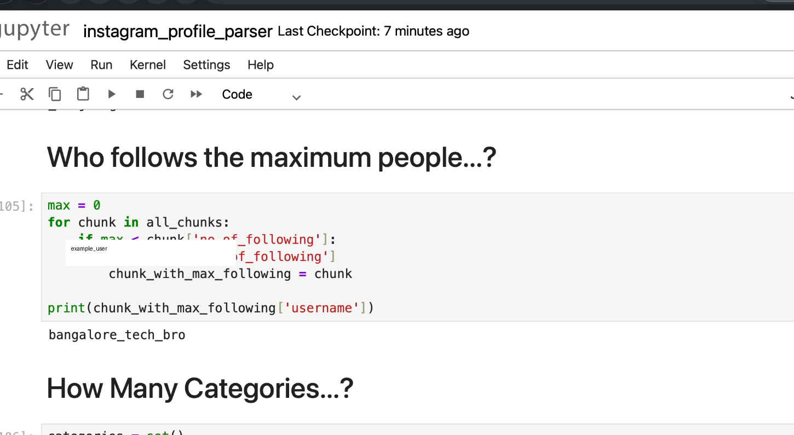

Instagram Profile Data Parser

A Python data parsing project that extracts and structures Instagram profile information from unstructured text data.

📌 Problem Statement

The input dataset contains Instagram profile information in an unstructured text format.

The objective of this project is to parse the raw text and convert each profile into a structured Python dictionary.

The project extracts the following information:

- Username
- Number of posts
- Number of followers
- Number of following
- Bio

🔄 Project Workflow

```text
Raw Text Data
      ↓
Split Data into Chunks
      ↓
Parse Each Chunk
      ↓
Extract Profile Information
      ↓
Store Data in Dictionaries
      ↓
Convert into Structured Data
      ↓
Analyze the Data


🛠️ Technologies Used

- Python
- Jupyter Notebook
- JSON

🧠 Python Concepts Used

- Lists
- Dictionaries
- Functions
- Loops
- String manipulation
- List comprehension
- Exception handling
- Data parsing
- Set operations

📊 Analysis Performed

The project performs basic analysis on the parsed profile data, including:

- Finding the profile with the maximum number of posts
- Finding the profile with the maximum number of followers
- Finding the profile following the maximum number of accounts
- Finding the number of unique profile categories

💡 Example Output

```python
{
    "username": "example_user",
    "no_of_posts": 120,
    "no_of_followers": 1500,
    "no_of_following": 300,
    "Bio": "Python Developer",
    "type_of_page": "Personal Blog"
}


🖼️ Project Output
The notebook performs analysis on the structured profile data.


📚 What I Learned
Through this project, I learned how to:
Process unstructured text data
Split large datasets into meaningful chunks
Extract information using Python string operations
Convert unstructured data into dictionaries
Work with lists of dictionaries
Handle IndexError and ValueError
Debug parsing-related problems
Perform basic analysis on structured data


⚠️ Data Privacy
The original dataset used during development contains real profile information and is not included in this public repository.
Only the code, documentation, and anonymized example output are included.


🚀 Future Improvements
Use Regular Expressions for more reliable parsing
Convert the data into a Pandas DataFrame
Export processed data to CSV
Add data validation
Add automated tests
Perform more detailed data analysis

```
👨‍💻 Author
Mandeep Kumar


🖼️ Project Output

The notebook performs analysis on the structured profile data.

